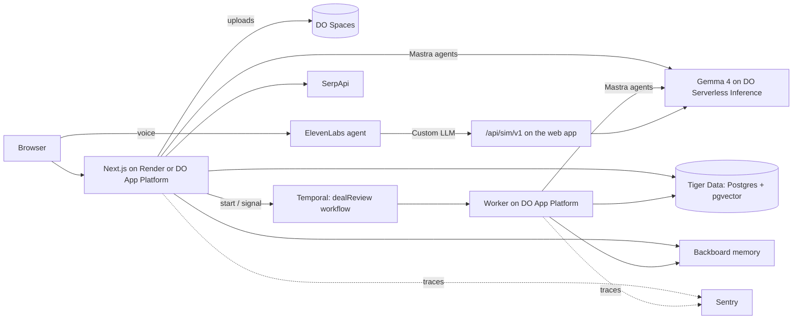

# Panga

**Know what you're agreeing to.** An AI deal room for freelancers who sell websites at fixed prices.

Paste a client's brief and messages. Panga finds the hidden work (with the client's exact words as evidence), shows what the deal really pays per hour, lets you rehearse the difficult call against a simulated client, and drafts a reply you can defend. Then it answers one question:

> *Lena hai, negotiate karna hai, ya chhodna hai?*
> **Take it · Change the deal · Walk away**

Built on **Gemma 4**, an open-weight model, served by **DigitalOcean Serverless Inference**. Built for the Hacktoberfest 2026 Open-Source AI Challenge (Week 2, "Side Hustle"). MIT licensed.

**Live demo:** https://panga-gnb2.onrender.com (free instance, so the first visit after a quiet spell can take about a minute to wake up). Click **Try the sample deal**.

---

## The journey

| Step | What happens |
| --- | --- |
| **1 · Dossier** | Gemma reads the brief, chat export, PDF or voice note. Each work item must quote the client verbatim; Panga checks every quote against the source and rejects any it can't find. Items nobody mentioned are marked *inferred* and aren't priced until you confirm them. Unfamiliar work can be researched on the web with sources. Similar past projects show how long they really took. |
| **2 · Economics** | Effective hourly rate, floor price, gap to floor, and a "what if the scope grows" scenario. Plain code, unit-tested, every figure shows its formula. The model never does the maths. |
| **3 · Client from hell** | A simulated client, built only from this brief, calls you (text or voice) and pushes on every gap at the difficulty you choose. Every line is labelled hypothetical and linked to the brief line behind it. The replay highlights what you accidentally promised and turns it into scope decisions. |
| **4 · Decision** | Three options: a smaller package within the budget, the full scope repriced, or a polite decline. Gemma drafts the reply in your tone; Panga flags any amount in the draft it didn't calculate. You approve and send it yourself. |
| **Afterwards** | Record how many hours it really took. The deal joins your past-project library, so the next similar brief is quoted with that lesson in mind. |

## How each open-source and partner technology is used

| Technology | What it does in Panga | Where |
| --- | --- | --- |
| **Gemma 4 (open weights)** | Reads briefs, plays the simulated client, analyses rehearsal replays, explains research, drafts replies. | `src/mastra/index.ts`, `src/server/prompts.ts` |
| **DigitalOcean** | *Serverless Inference* serves Gemma (`gemma-4-31B-it`) and embeddings through its OpenAI-compatible API. `.do/app.yaml` deploys the web app and the Temporal worker to *App Platform*. *Spaces* keeps original PDFs and voice notes, private, behind five-minute signed links. | `src/server/llm.ts`, `src/server/embeddings.ts`, `src/server/spaces.ts` |
| **Mastra** | Four agents (scope analyst, researcher, client simulator, proposal writer) on Gemma, with per-call instructions and streaming. | `src/mastra/index.ts`, `src/server/llm.ts` |
| **Temporal** | One durable workflow per deal: analysis with retries (configuration errors fail fast), waits for rehearsals and approval, then a two-week timer that asks how the project went. Tested on Temporal's time-skipping server. | `src/server/temporal/*` |
| **Tiger Data** | Postgres with pgvector on a Tiger Cloud free service: deals, past projects with embeddings, and hybrid search (vector similarity + full-text rank). Locally the same SQL runs on PGlite. | `src/server/db.ts`, `src/server/projects-repo.ts` |
| **Render** | Hosts the live demo on a free web service, redeploying on every push to `main`. | Render dashboard (settings below) |
| **ElevenLabs** | Voice rehearsal: an ElevenLabs agent whose *Custom LLM* is Panga's endpoint, so Gemma decides what the client says while ElevenLabs handles speech. Also speech-to-text for client voice notes. | `src/app/api/sim/v1/chat/completions/route.ts`, `src/components/deal/VoiceCall.tsx`, `scripts/setup-elevenlabs-agent.mjs` |
| **SerpApi** | "What does this involve?" research on unfamiliar requirements, with numbered, linked sources. Uncited claims are dropped. | `src/server/serp.ts`, `src/server/pipeline.ts` |
| **Backboard** | Remembers your minimum rate, tone, work you never include, and the corrections you make to extracted scopes. Recalled notes are given to the scope analyst on the next brief. | `src/server/memory.ts` |
| **Sentry** | Mastra's Sentry exporter traces every agent run and model call (tokens, latency); custom spans cover quote verification and research. | `src/mastra/index.ts`, `src/server/report.ts`, `src/instrumentation.ts` |

Every integration is optional except the model: without a key, that feature switches off and the rest keeps working. The Memory & library page shows what's on.

## Trust rules (enforced in code)

1. **Every requirement has evidence.** Quotes are matched against the source text (`src/lib/evidence.ts`); the stored quote is always the client's exact text. Edits from the browser are re-verified on the server.
2. **Every number has visible inputs.** `src/lib/economics.ts` returns each figure with its formula.
3. **Simulated objections are labelled hypothetical**, and the simulated client may only raise work that has a client quote.
4. **Evaluate the work, not the person.** No client scores; prompts forbid judging the client.
5. **The freelancer approves everything.** Panga never sends a message.
6. **Client data stays deletable.** Deleting a deal removes its uploads, call tokens and library entry.

## Architecture



Without `TEMPORAL_ADDRESS`, the same pipeline steps (`src/server/pipeline.ts`) run in the background of the web process.

## Run it locally in two minutes, with no keys

Everything can run against local stand-ins for DigitalOcean, SerpApi, Backboard, ElevenLabs and Spaces:

```bash
npm install
```

```bash
npm run mock:services
```

In a second terminal:

```bash
npm run dev:mock
```

Open http://localhost:3100 and click **Load the sample deal**. The stand-in model returns a canned analysis for the sample (including one deliberately invented quote, so you can see it rejected).

## Run it with real Gemma

1. Create a **Model Access Key** in the DigitalOcean control panel (Serverless Inference).
2. `cp .env.example .env.local` and set `DO_MODEL_ACCESS_KEY`. Leave `PANGA_MODEL=gemma-4-31B-it`.
3. `npm run dev` and open http://localhost:3000.

Add other keys as you get them; each feature lights up on its own.

## Deploy to Render (free) with Tiger Data

This is how the live demo runs, at no cost.

1. Create a free service in [Tiger Cloud](https://console.cloud.tigerdata.com) (Shared compute, US East) and copy its connection string.
2. In Render: **New → Web Service**, pick this repository, branch `main`, region **Virginia** (next to the database), instance type **Free**.
3. Build command `npm ci && npm run build`. Start command `node --max-old-space-size=400 node_modules/next/dist/bin/next start`. Health check `/api/health`.
4. Environment variables: `DO_MODEL_ACCESS_KEY`, `DATABASE_URL` (the Tiger connection string), `PANGA_MODEL=gemma-4-31B-it`, `PANGA_EMBEDDING_MODEL=qwen3-embedding-0.6b`, `MASTRA_TELEMETRY_DISABLED=true`.

A hosted database is required on the free plan: the embedded PGlite database needs about 900 MB of memory, more than the free instance has. Tiger hands out `sslmode=require`, which Panga reads the libpq way (encrypted, certificate not pinned) so its private CA connects.

## Deploy to DigitalOcean App Platform

1. Push this repository to GitHub.
2. In DigitalOcean: **Apps → Create App → GitHub**, pick the repository and branch `main`. Or, with `doctl`, edit the repo name in `.do/app.yaml` and run `doctl apps create --spec .do/app.yaml`.
3. Region: Bangalore (`blr`) suits Indian users. Run command `npm start`, HTTP port `8080`, health check `/api/health`.
4. Add environment variables (mark keys as **Encrypted**): `DO_MODEL_ACCESS_KEY`, `PANGA_MODEL=gemma-4-31B-it`, and any of `DATABASE_URL`, `SPACES_*`, `TEMPORAL_*`, `ELEVENLABS_*`, `PANGA_SIM_SECRET`, `SERPAPI_API_KEY`, `BACKBOARD_API_KEY`, `SENTRY_DSN`. Set `NEXT_PUBLIC_SENTRY_DSN` with build-time scope.
5. For durable workflows, add a **Worker** component with run command `npm run worker` (needs `TEMPORAL_*` and `DATABASE_URL`).
6. For voice rehearsal, once the app has its https URL: set `PANGA_PUBLIC_URL`, `ELEVENLABS_API_KEY` and `PANGA_SIM_SECRET` in `.env.local`, run `npm run setup:voice`, and add the printed `ELEVENLABS_AGENT_ID` to the app.

Without `DATABASE_URL`, the app uses PGlite on the container's disk, which is reset on every deploy. Use Tiger Data for anything you want to keep.

## Tests

```bash
npm test
```

105 tests cover the economics (the PRD's worked example: 45 h, ₹333/h, ₹31,500 floor, ₹34,000 full price), quote verification, JSON repair, rehearsal tags and streaming tag stripping, reply amount checks (including price ranges like "12-15k"), scope building, linking replay promises to work items, server-side checks on edits (tampered evidence is dropped), the database layer against real Postgres semantics (PGlite with pgvector), and the deal workflow on Temporal's time-skipping server. `npm run typecheck` and `npm run build` must pass too.

## Project layout

```
src/
  app/                 Next.js pages and API routes (api/sim is the ElevenLabs endpoint)
  components/          The deal room UI
  lib/                 Pure logic shared by browser and server (economics, evidence, rehearsal)
  mastra/              Agents on Gemma
  server/              Pipeline, prompts, storage, integrations
    temporal/          Workflow, activities, worker, client
scripts/               Local stand-ins, ElevenLabs agent setup
docs/prd.html          The product requirements document
```

## Notes

- The client's work is private: deals are tied to a random key stored in the browser (copy it under Memory & library to use another device). There are no accounts.
- Model calls cost money, so each workspace is rate-limited (`PANGA_RATE_LIMIT`, `PANGA_DAILY_LIMIT`).
- This repository was started and built during the Week 2 challenge window (12–18 October 2026).
